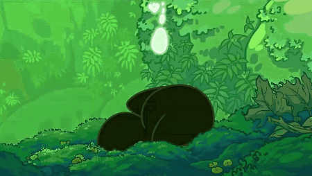

## About Me

- I'm 18, currently pursuing a Diploma in Computer Science.
- Mostly working on projects related to Minecraft 
- I like cats. A lot.

  

## Currently Active Projects

| Project | Description |
|---------|-------------|
| [CoreUi](https://github.com/CrebsTheCoder/CoreUi) | WIP Java UI library inspired by OreUI. |
| [skPackets](https://github.com/CrebsTheCoder/skPackets) | A Skript addon adding packet syntaxes. |

## Languages & Tools

**Languages**

  

**Runtime & Development**

  

**Tools & Environment**

  

## GitHub Stats

